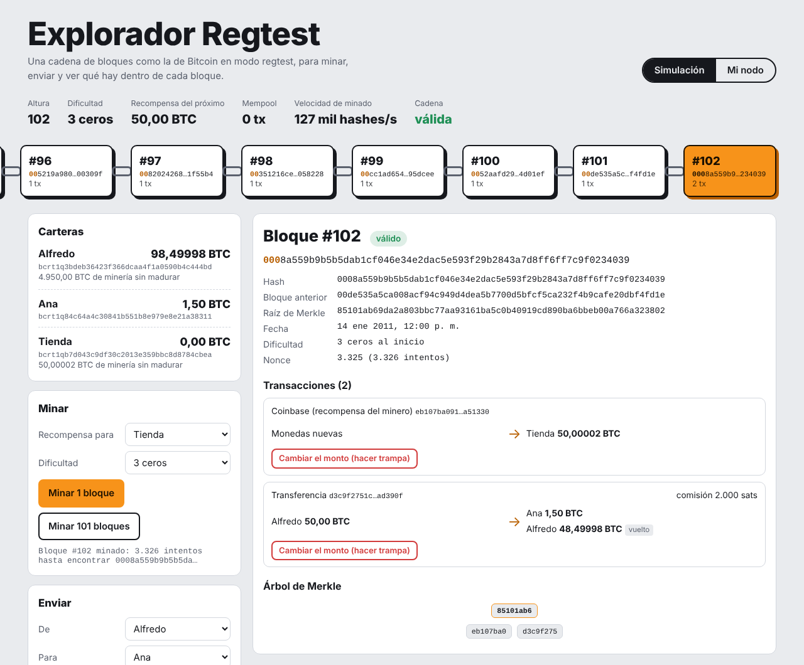

# Explorador Regtest

Una cadena de bloques **al estilo de Bitcoin en modo regtest** que corre en el navegador: minas bloques con prueba de trabajo de verdad (SHA-256 doble), envías transacciones entre carteras y miras por dentro cada bloque. También se puede **conectar a un nodo Bitcoin Core real** en regtest para explorar sus bloques.

**Pruébalo:** https://acruzc23-crypto.github.io/explorador-bitcoin/



## Qué puedes hacer

- **Minar** bloques eligiendo la dificultad (cuántos ceros debe tener el hash al inicio) y ver el nonce probando valores en vivo.
- **Minar 101 bloques** de una vez, igual que en Bitcoin Core: las monedas de minería solo se pueden gastar cuando tienen **más de 100 confirmaciones**.
- **Enviar** BTC entre tres carteras. La transacción usa salidas no gastadas (UTXO), devuelve el **vuelto** al remitente y la **comisión** se la lleva quien mine el siguiente bloque.
- Ver la **mempool**, la cabecera de cada bloque, sus transacciones y su **árbol de Merkle**.
- **Hacer trampa**: cambiar el monto de una transacción ya confirmada y ver cómo el bloque queda inválido.
- **Mi nodo**: con el puente incluido, leer los últimos bloques y la mempool de tu `bitcoind -regtest`.

## Reglas que copia de Bitcoin

| Regla | Valor |
| --- | --- |
| Hash de bloques y transacciones | SHA-256 aplicado dos veces |
| Recompensa inicial | 50 BTC |
| Halving en regtest | cada 150 bloques |
| Madurez de la coinbase | más de 100 confirmaciones |
| Merkle con número impar de hojas | se duplica la última |

Lo que **no** tiene, para mantenerlo simple: firmas digitales, scripts, ajuste de dificultad ni red entre nodos. Las direcciones tienen el prefijo `bcrt1q` pero no son bech32 válidas.

## Conectar tu nodo regtest

El navegador no puede usar el RPC de Bitcoin Core directamente, así que `nodo/proxy.js` hace de puente. Solo permite métodos de lectura (`getblock`, `getblockhash`, `getrawmempool`…) y rechaza cualquier cosa que gaste o cambie algo, como `sendtoaddress` o `stop`.

```bash
bitcoind -regtest -daemon
BITCOIN_RPC_COOKIE=~/.bitcoin/regtest/.cookie npm run nodo
# o: BITCOIN_RPC_USER=usuario BITCOIN_RPC_PASS=clave npm run nodo
```

Luego, en la página, elige **Mi nodo** y conecta a `http://127.0.0.1:18080`.

## Cómo está hecho

- `src/sha256.js`: SHA-256 en JavaScript puro, comprobado contra el de Node.
- `src/cadena.js`: UTXO, mempool, minado, validación de bloques y de la cadena.
- `src/nodo.js` y `nodo/proxy.js`: lectura de un nodo real.
- Sin frameworks ni dependencias.

```bash
npm test                 # 12 pruebas: hashing, madurez, vuelto, doble gasto, Merkle, trampa y el puente
python3 -m http.server   # y abrir http://localhost:8000
```

## Contexto

Lo hice después de mi laboratorio con Bitcoin Core en regtest, donde creé una cartera, miné 101 bloques y envié transacciones por RPC. Quería ver qué pasa por dentro. El código se escribió con ayuda de Claude (IA de Anthropic); yo definí qué debía hacer, lo revisé y lo probé.

Alfredo Cruz, estudiante de Ingeniería en Software, Milagro, Ecuador.

## Licencia

MIT
